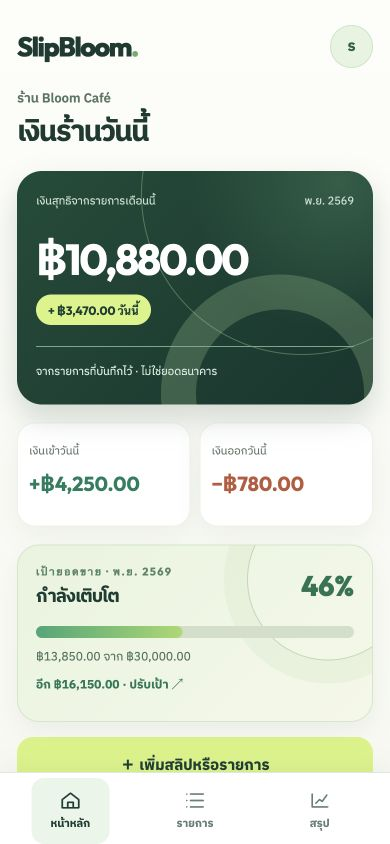
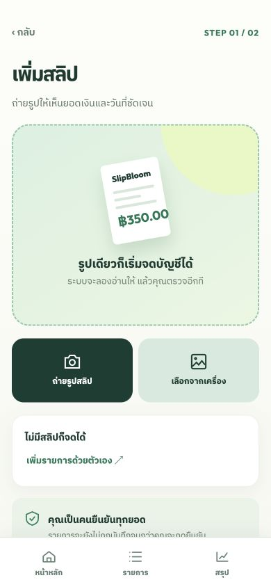
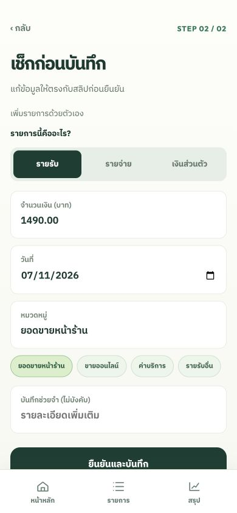
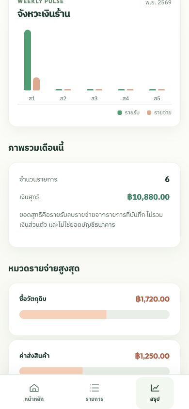

# SlipBloom

SlipBloom is a private bookkeeping web app for small Thai shops. A shop owner can record income and expenses manually or upload a payment slip, review OCR suggestions, avoid accidental duplicates, set a monthly sales goal, view weekly income and expense trends, inspect monthly totals, and export CSV.

**Built for the everyday rhythm of a small shop:** capture a slip, check the details, and see the money coming in and going out. The interface is in Thai and adapts to phones and desktop screens.

## Screenshots

These screenshots use a fictional shop and sample transactions.

| Dashboard and goal | Add a slip | Review an entry | Weekly insights |
| --- | --- | --- | --- |
|  |  |  |  |

## Run locally

Requires Node.js 24 or newer. No npm packages are needed.

```sh
cd /path/to/SlipBloom
npm start
```

Open `http://127.0.0.1:8787`, create an account, and start recording. Data is stored in `data/slipbloom.sqlite`; uploaded images are in `data/uploads`. The `data` directory is excluded from Git. To change settings, export the environment variables listed in `.env.example` before starting the server.

The optional Tesseract command provides OCR suggestions. Install the Thai language pack (`tha`) for Thai text; without it the app attempts English OCR. OCR output is never booked automatically. The owner must confirm the amount, date, type, and category.

## Backup and recovery

Run `npm run backup` while the server is running or stopped. It creates a consistent SQLite snapshot and copies uploaded slips under `data/backups/<timestamp>/`. Set `BACKUP_DIR` to store backups on a separate disk. Backups on the same disk do not protect against disk failure. Test recovery by stopping the server and restoring the snapshot database and `uploads/` directory into a separate `DATA_DIR`.

## Deployment notes

The default host binds only to the local computer. For access over a network, place the app behind an HTTPS reverse proxy, set `PUBLIC_ORIGIN` to the exact public HTTPS origin, and configure `HOST` and `PORT` for the private upstream. The session cookie becomes `Secure` when `PUBLIC_ORIGIN` starts with `https://`. Restrict access to `DATA_DIR` and `BACKUP_DIR`, enable encrypted offsite backups, and monitor disk space. Do not put the data directory under `public/`.

This release supports one owner and one shop per account, manual entries, slip review, monthly sales goals, weekly trends, monthly summaries, CSV export, and soft deletion. A goal tracks recorded income for the selected month. It does not provide bank reconciliation, tax filing, user roles, password reset, or multi-device conflict handling. Do not treat totals as a bank balance or tax statement.

## Checks

```sh
npm test
```
